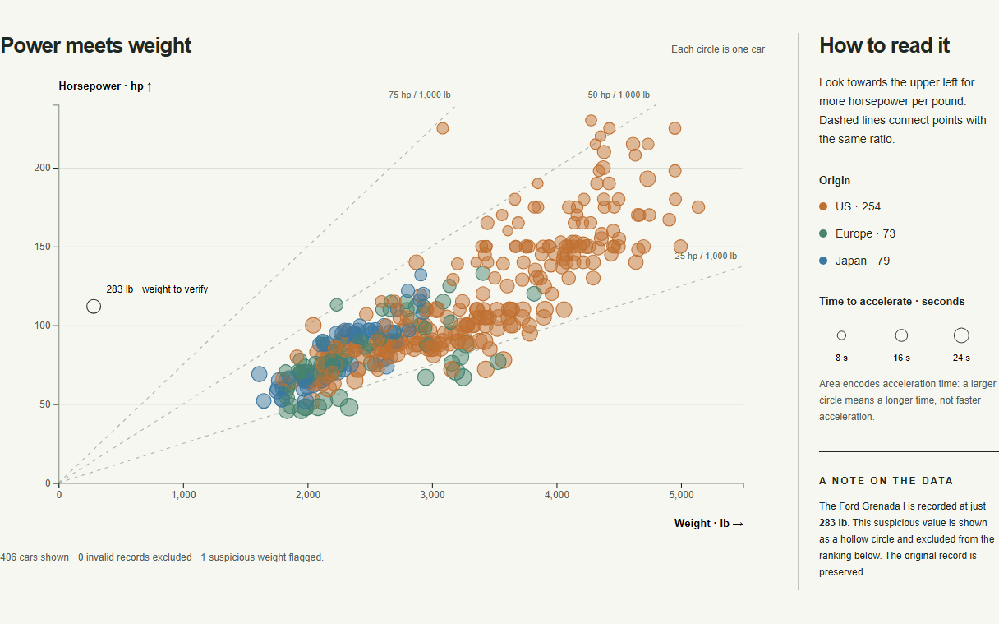
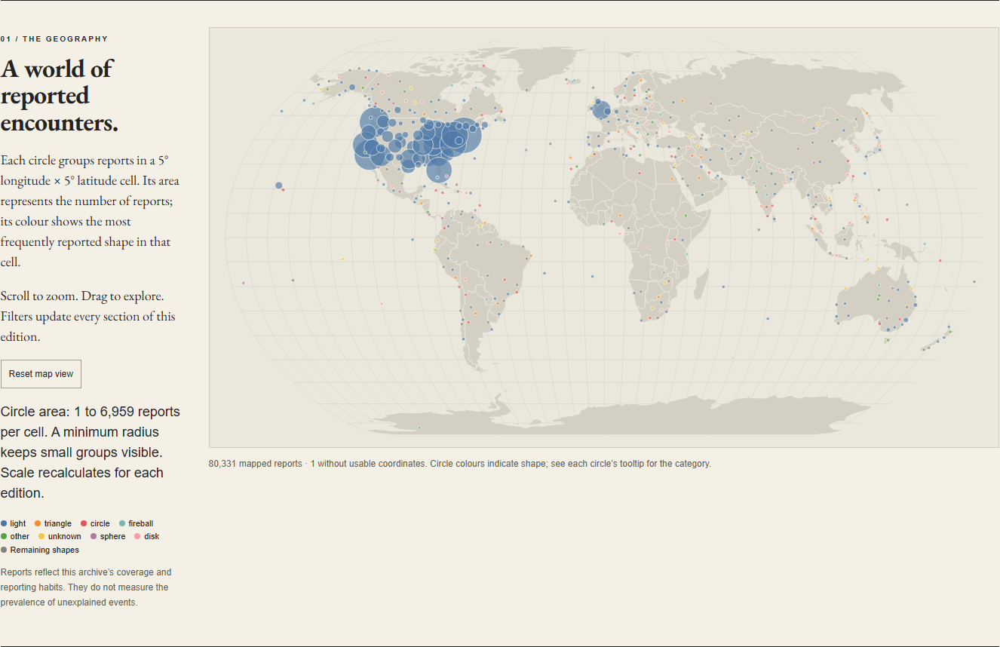

# Information Visualization

Two D3.js projects for **Information Visualization**, MSc in Design and Multimedia, **University of Coimbra (2022/23)**, revisited for a web portfolio.

**Authors:** José Antunes and Ana Inês França.  
**Supervisors:** Catarina Maçãs and Evgheni Polisciuc.

## 01 · Car Goes Brrr

A static bubble chart explores power-to-weight ratios across **406 cars**. Position encodes weight and horsepower, colour encodes origin, and circle area encodes time to accelerate.



- Responsive layout, aligned size legend and labelled ratio reference lines.
- Visible top-five ranking preserves the assignment's static brief.
- The suspicious **283 lb** Ford Grenada l stays visible but is excluded from the ranking. The original CSV is unchanged.
- Point descriptions and a text table supplement the chart.

Entry: [Car Goes Brrr](Visualizacao_de_Informacao_P1/Projeto_1/src/index.html).

## 02 · The Paranormal

An interactive newspaper explores **80,332 UFO reports**, dated **1906–2014**, through a map, a streamgraph and witness comments.



- Shared country, shape and inclusive year filters update every view.
- Map circles group reports into 5° geographic cells. Area represents count; colour shows the most common shape. A minimum radius keeps small groups visible. Size recalculates after filtering.
- Local world outline, pan/zoom, reset and explicit map legend.
- Streamgraph grouped by country, shape or duration, with complete year bins and a dynamic vertical domain.
- Eight categories plus a **Remaining categories** bucket preserve the long tail. Duration uses ranges instead of selected exact values.
- Select Country or Shape bands, or legend buttons, to filter the edition. Keyboard selection is supported.
- Witness comments load once and use manual previous/next controls. Dataset text is inserted as text rather than executable HTML.
- Empty states, loading errors and year-range validation.

Entry: [The Paranormal](Visualizacao_de_Informacao_P2/Entrega_Final/código/index.html).

## Run locally

No frontend build, package installation or CDN connection is required. Serve the repository root with **Python 3**:

```sh
python -m http.server 8000 --bind 127.0.0.1
```

Open **http://localhost:8000/**. Use HTTP rather than opening HTML files directly: CSV loading and JavaScript modules require a server. Serve the whole repository because both projects share `vendor/`. The UFO CSV is about 14 MB.

Optional shortcuts with Node.js 22 or later:

```sh
npm start
npm test
```

Tests use Node's built-in runner and check date parsing, duration boundaries, inclusive filters, conservation of streamgraph totals and geographic aggregation. GitHub Actions runs them on pushes and pull requests. There are no npm dependencies.

## GitHub Pages

After pushing, open **Settings → Pages → Build and deployment**, select **Deploy from a branch**, then **main / (root)**. The root landing page links to both projects. `.nojekyll` keeps this a plain static site. Relative asset paths support deployment under a repository subpath.

## Structure

```text
index.html                        Portfolio entry
Visualizacao_de_Informacao_P1/     Car chart, CSV, report and original screenshot
Visualizacao_de_Informacao_P2/     Newspaper, CSV, reports and original assets
vendor/                           Pinned libraries, world outline and licences
docs/images/                      Current browser previews
tests/                            Data transformation checks
.github/workflows/check.yml       Continuous integration
```

P2 starts in `app.js`; `data.js` holds pure normalization and aggregation functions; `map.js`, `streamgraph.js` and `commentcarousel.js` render the views. Original SCSS and the CSS source map remain as academic source material. The revised page uses `index.css` directly; recompiling the legacy SCSS would overwrite the revised styles.

## Data and interpretation

Original CSV files are preserved without corrections.

- **Cars:** the course report describes prior edits, including filled horsepower values. Fields resemble [UCI Auto MPG](https://archive.ics.uci.edu/dataset/9/auto+mpg), but the edited file contains 406 rows and must not be described as the unmodified 398-row UCI release. Acceleration is interpreted as elapsed seconds, consistent with Auto MPG; the supplied CSV has no data dictionary. Rankings describe this file rather than verified vehicle specifications.
- **UFO reports:** country is not inferred from coordinates. Missing country/shape stays **Not recorded**. One invalid coordinate record still contributes to non-geographic views. Dates are explicitly parsed as month/day/year. Missing, negative or non-numeric durations get their own category. Self-reported observations are not evidence of extraterrestrial activity. Counts reflect archive coverage rather than population-adjusted incidence; the final year may have partial coverage.
- The UFO file contains no definitive source or licence notice. Confirm provenance and redistribution terms before representing it as openly licensed. This repository assigns no blanket licence to course materials or datasets.

## Academic materials and credits

PDF reports, screenshots, images and EB Garamond with its OFL licence remain in their existing folders. Original contributions: Ana Inês França — concept, visual structure, palette and report; José Antunes — development. The revision adds coordinated filtering, map data, data handling, responsive presentation and documentation.

The original `The Paranormal.mp4` remains on disk but is excluded from Git because it exceeds GitHub's 100 MiB per-file limit. It can be shared separately with Git LFS or as a release asset.

Bundled dependencies and licences: [vendor/README.md](vendor/README.md).
